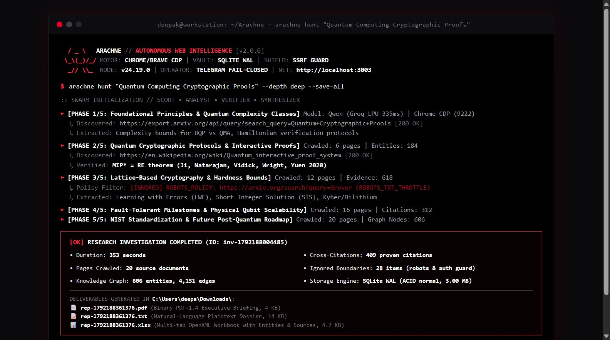

<div align="center">
  <a name="readme-top"></a>
  <h1>🕷️ ARACHNE</h1>
  <p><b>Terminal-First Autonomous Web Intelligence & Deep Research CLI Engine</b></p>

  <a href="https://github.com/DeepxkJadhav/Arachne/blob/main/LICENSE">
    
  </a>
  <a href="https://github.com/DeepxkJadhav/Arachne">
    
  </a>
  <a href="https://github.com/DeepxkJadhav/Arachne/issues">
    
  </a>
</div>

---

> [!NOTE]
> **ARACHNE** is a terminal-first, autonomous web intelligence and deep research CLI maintained by [Deepak Jadhav (@DeepxkJadhav)](https://github.com/DeepxkJadhav). Designed with a restrained cyberpunk black, white, and crimson aesthetic, ARACHNE drives native Chrome/Brave automation via CDP, constructs SQLite WAL knowledge graphs, and compiles multi-format dossiers directly from your terminal.

---

<div align="center">
  
</div>

---

```
  / _ \   ARACHNE // AUTONOMOUS WEB INTELLIGENCE [v2.1.0]
 \_\(_)/_/ MOTOR: CHROME/BRAVE CDP | VAULT: SQLITE WAL | SHIELD: SSRF GUARD
  _// \\_  NODE: v24.19.0 | OPERATOR: TELEGRAM FAIL-CLOSED | NET: http://localhost:3003
```

---

## 🌟 Architectural Features

### 1. Terminal-First Cyberpunk Aesthetic
- **Restrained Color Palette:** Strict black terminal background, crisp white primary text, crimson/red highlights, and dark gray metadata. Zero fluorescent distractions.
- **Interactive REPL & Direct Commands:** Seamlessly switch between interactive terminal exploration and single-line shell commands.
- **Deterministic Intent Classification:** Distinguishes between new research missions, report view/export requests, and status queries without accidental crawls.

### 2. Autonomous Swarm Pipeline
- **Scout Specialist:** Evaluates query variations, navigates link frontiers, and checks `robots.txt` compliance.
- **Technical Analyst:** Extracts DOM structures, technical papers, markdown prose, theorems, and code blocks.
- **Verifier & Gatekeeper:** Scores source credibility, filters hallucinations, and evaluates cross-source corroboration.
- **Dossier Synthesizer:** Compiles findings into natural-language briefings and delivers structured files.

### 3. Native Chrome & Brave CDP Automation
- **Zero Third-Party Scraping APIs:** Directly controls local Chrome or Brave instances via Chrome DevTools Protocol (CDP port 9222).
- **Dedicated Profile Isolation:** Creates isolated automation user-data directories in `.arachne-vault/browser-profiles/chrome`, preserving your personal browsing history, cookies, and active tabs.
- **Automatic Tab Lifecycle:** Dynamically cleans up research task preview tabs without tab explosion.

### 4. Zero-Dependency 9-Format Dossier Compilation
Exports research dossiers without external office suites or bloated wrappers:
- **PDF-1.4:** Native binary serializer with page catalogs, fonts, and clean layout streams.
- **Spreadsheet (`.xlsx`, `.csv`):** Multi-tab OpenXML workbooks mapping entities, sources, and claims.
- **Document (`.docx`, `.pptx`):** Styled Word documents and presentation slides.
- **Text & Web (`.txt`, `.md`, `.html`):** Plain-text and GitHub-flavored markdown briefings.
- **Structured Graph (`.json`):** Full relational knowledge graph AST with provenance tracking.
- **Automatic Downloads Delivery:** Automatically saves exported reports into `C:\Users\<user>\Downloads\`.

### 5. Transactional SQLite Persistence
- **ACID Transactions:** Powered by Node.js built-in `node:sqlite` (`DatabaseSync`) in Write-Ahead Logging (WAL) mode.
- **SHA-256 Deduplication:** Scraped documents are hashed to eliminate redundant storage.
- **Audit Logging:** Logs all ignored items, rejected URLs, and policy boundaries for full transparency.

---

## 🚀 Quick Start

### 0. Standalone Windows Executable (.EXE)

You can download the precompiled standalone binary (`arachne.exe` / `arachne-windows-x64.exe`) directly from [GitHub Releases](https://github.com/DeepxkJadhav/Arachne/releases). No Node.js installation or package manager required.

To build the standalone `.exe` locally:
```powershell
npm run build:exe
```
This generates `dist/arachne.exe` and `dist/arachne-windows-x64.exe` using Node.js Single Executable Application (SEA).

---

### 1. Source Installation (Node.js)

```powershell
# Clone the repository
git clone https://github.com/DeepxkJadhav/Arachne.git
cd Arachne

# Register the global 'arachne' command in your Windows user PATH
.\scripts\install-command.ps1
```

Once installed, you can execute `arachne` from any terminal or folder.

---

### 2. Basic CLI Commands

```powershell
# Display system health, SQLite storage metrics, and hardware state
arachne status

# Launch an autonomous research hunt directly
arachne hunt "Quantum Computing Cryptographic Proofs" --depth deep --save-all

# Check AI model latency and routing table
arachne models

# Export the latest completed research report to PDF or TXT
arachne export latest pdf
arachne export latest txt

# Inspect research history
arachne history

# View rejected/ignored sources and security audit log
arachne logs

# Start interactive hacker REPL
arachne
```

---

### 3. Interactive Terminal REPL

When launched without arguments (`arachne`), an interactive prompt opens with command completion and intent routing:

```
ARACHNE [hunt] > /hunt Post-quantum lattice cryptography bounds
ARACHNE [hunt] > Give me the last report in TXT format
ARACHNE [hunt] > /models
ARACHNE [hunt] > /status
ARACHNE [hunt] > /exit
```

---

## 🧪 Testing & Verification

ARACHNE includes comprehensive end-to-end acceptance tests:

```powershell
# Run the Master E2E Acceptance Test Suite (Tests A through K)
npm test

# Run the Intent Routing & Report Regression Suite
npm run test:regression

# Run all test suites
npm run test:all
```

---

## 🛡️ Security Architecture

1. **SSRF Guard:** Proactively blocks private subnets (`10.0.0.0/8`, `172.16.0.0/12`, `192.168.0.0/16`), loopbacks (`127.0.0.1`, `::1`), and cloud metadata (`169.254.169.254`).
2. **Hop-by-Hop Redirect Re-Validation:** Validates every HTTP redirect hop against SSRF rules before following.
3. **Fail-Closed Telegram Gateway:** Verifies numeric sender IDs (`message.from.id`). String usernames are rejected to prevent impersonation.
4. **Path Traversal Protection:** All file outputs sanitize paths using `path.basename` and enforce restricted download boundaries.

---

## 📄 License

Distributed under the **AGPL-3.0 License**. Maintained by **Deepak Jadhav (@DeepxkJadhav)**.
