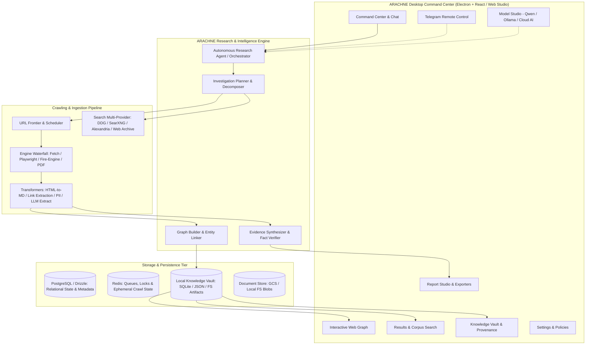

# ARACHNE System Architecture

## 1. System Vision & Architecture Overview

ARACHNE is an autonomous web-intelligence platform and multi-source research system. It integrates three foundational pillars:

1. **Independent Search & Crawling Engine:** Discover, crawl, index, rank, and preserve web content without sole reliance on proprietary search APIs.
2. **Web Intelligence & Knowledge Graph Engine:** Interconnect domains, documents, entities, citations, and repositories into a queryable relational and topological graph.
3. **Autonomous Research Agent:** Translate high-level user directives into structured investigation plans, dispatch permission-aware crawl/search actions, analyze evidence iteratively, recover from errors, and compile multi-format research deliverables.

---

## 2. High-Level Architectural Diagram

---

## 3. Subsystem Breakdown

### 3.1 Desktop Application & Command Center
- **Framework:** Electron / Modern Web Client with TypeScript, React, and Tailwind/Lucide styling.
- **Visual Design:** Void-black (`#0a0812`) and deep-purple (`#120d24`) theme with neon violet, magenta, crimson, and cyan accents, subtle spiderweb geometry, and responsive multi-pane layout.
- **Screens:**
  1. **Command Center:** Natural-language investigation intake, live phase status, real-time metrics, live topology preview, streaming execution logs.
  2. **Web Graph:** Interactive force-directed topology (domains, documents, entities, citations) with filtering, neighborhood expansion, and path tracing.
  3. **Results & Search:** Corpus search, relevance scoring, facet filters, snippet previews, and citation traceability.
  4. **Report Studio:** Multi-format research reports (Markdown, PDF/HTML, JSON, CSV, Excel) with executive summaries and evidence matrices.
  5. **Model Studio:** Provider configuration (local Ollama/Qwen, OpenAI, Anthropic, OpenRouter), latency benchmarks, and role routing.
  6. **Knowledge Vault:** Persistent collections, bookmarks, revision history, and source provenance.
  7. **Telegram Control:** Remote polling and webhook dispatcher for mobile task trigger and status alerts.
  8. **Settings:** Per-domain crawl rate limits, robots.txt strictness, storage quotas, and security boundaries.

### 3.2 Autonomous Research Agent (`src/lib/deep-research/` & `src/controllers/v2/agent*.ts`)
- **Decomposition:** Breaks open-ended objectives into targeted search queries, exploration bounds, and verification questions.
- **Execution Loop:**
  1. *Formulate:* Generate hypothesis-driven search & seed queries.
  2. *Discover:* Query search providers and expand links from seed pages.
  3. *Extract:* Parse relevant sections, extract claims, entities, authors, and citations.
  4. *Evaluate:* Detect contradictions, missing evidence, or low confidence.
  5. *Iterate:* Recurse up to configurable depth and budget limits.
  6. *Synthesize:* Compile structured research dossier.

### 3.3 Crawling & Discovery Engine (`apps/api/src/scraper/`)
- **Multi-Engine Waterfall:**
  - `fetch` (Undici): Ultra-fast HTTP fetching for static markup.
  - `playwright`: Dynamic DOM rendering and JS evaluation.
  - `fire-engine`: Headless Chrome DevTools Protocol (CDP) with stealth fingerprinting.
  - `pdf` / `document`: PDF and document parsing with OCR fallback.
- **URL Frontier & Scheduler:**
  - Canonicalization and duplicate URL pruning.
  - Per-domain concurrency limits and exponential backoff jitter.
  - Robots.txt parser and scope constraint enforcement.
- **Search Integrations (`apps/api/src/search/`):**
  - DuckDuckGo zero-config search.
  - SearXNG meta-search gateway.
  - Alexandria historical web archives.

### 3.4 Storage & Intelligence Layer
- **Relational / Schema:** Drizzle ORM on PostgreSQL for enterprise multi-tenant state and job auditing.
- **Local Vault:** Embedded zero-dependency file-backed SQLite/JSON storage for single-node / offline execution.
- **Knowledge Graph:** Directed multigraph storing:
  - Nodes: `Domain`, `Page`, `Document`, `Repository`, `Author`, `Entity`, `Topic`.
  - Edges: `LINKS_TO`, `CITES`, `AUTHORED_BY`, `MENTIONS`, `HOSTED_ON`, `SIMILAR_TO`.

---

## 4. Operational Modes

1. **Standalone Desktop / Local Mode:**
   - Runs with zero external container dependencies.
   - Uses embedded Node runtime, local file-backed persistence, and direct search/fetch adaptors.
   - Connects to local Ollama (Qwen 2.5 / DeepSeek) or remote API endpoints.
2. **Distributed Enterprise Mode (Firecrawl-Compatible):**
   - Spins up full containerized stack via Docker Compose (`apps/api`, `playwright-service`, `nuq-postgres`, `redis`, `rabbitmq`).
   - Uses distributed NuQ queues and PostgreSQL read-replicas.
