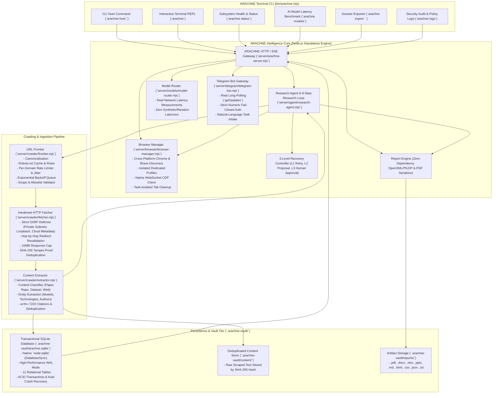

# ARACHNE System Architecture

## 1. System Vision & Architecture Overview

**ARACHNE** is an independent, permission-aware web intelligence and autonomous research platform. It unifies three core operational systems:

1. **Independent Search & Crawling Engine:** Discover, crawl, index, rank, and preserve permitted web content through native Chrome DevTools Protocol (CDP) automation and hardened SSRF-defended HTTP fetchers without reliance on third-party scraping APIs.
2. **Web Intelligence & Knowledge Graph Engine:** Interconnect domains, documents, entities, citations, and repositories into a queryable relational and topological graph with BFS path tracing.
3. **Autonomous Research Agent:** Translate natural-language directives into structured investigation plans, execute an explicit 8-step live research loop, analyze evidence iteratively via an Evidence Sufficiency Evaluator, recover from failures using a 3-level recovery controller, and compile multi-format research deliverables.

---

## 2. High-Level Architectural Diagram

---

## 3. Core Architectural Subsystems

### 3.1 Browser Automation Management (Chrome & Brave)

ARACHNE directly interacts with modern web interfaces using Google Chrome and Brave Browser without relying on third-party scraping APIs:
1. **Cross-Platform Browser Discovery:** Detects Chrome and Brave executable paths across Windows (`Program Files`, `LocalAppData`), macOS (`/Applications`), and Linux (`/usr/bin/`).
2. **Profile Discovery & Isolation:** Parses browser `Local State` in a read-only, non-locking manner to discover configured profiles without touching personal user data.
3. **Dedicated Profile Protection:** Spawns automation sessions inside dedicated directory trees:
   - Chrome: `.arachne-vault/browser-profiles/chrome/`
   - Brave: `.arachne-vault/browser-profiles/brave/`
   This isolates task cookies, cache, and history from personal user profiles.
4. **WebSocket CDP Client:** Native DevTools protocol client communicating with Chrome's remote debugging port (9222) via WebSocket:
   - Page screencasting (`Page.captureScreenshot` Base64 stream)
   - Real-time DOM and accessibility tree inspection
   - Viewport resizing and navigation lifecycle
5. **Task-Isolated Tab Lifecycle:** Tracks tabs opened specifically for ARACHNE research tasks in `BrowserManager.activeTaskTabs`. When navigating to candidate pages, previous task preview tabs are systematically closed via `/json/close/{targetId}`, ensuring user tabs remain untouched.

---

### 3.2 Live Research Loop & Evidence Sufficiency Evaluator

The research agent executes an 8-step iterative crawl loop:

$$\text{OBSERVE} \longrightarrow \text{INSPECT} \longrightarrow \text{EXTRACT} \longrightarrow \text{EVALUATE} \longrightarrow \text{SELECT NEXT} \longrightarrow \text{NAVIGATE} \longrightarrow \text{VERIFY} \longrightarrow \text{REPEAT}$$

1. **Observe:** Inspect current page viewport and status.
2. **Inspect:** Examine DOM structure, semantic headings (`h1`-`h4`), and hyperlink elements.
3. **Extract:** Parse body text, citations (arXiv, DOI), code snippets, and entities.
4. **Evaluate (Evidence-Sufficiency Evaluator):**
   - Assesses question coverage: how many objective questions are answered by accumulated corpus.
   - Computes domain diversity: prevents over-indexing on a single domain.
   - Evaluates corroboration score: checks whether facts are supported by multiple independent sources.
   - If confidence exceeds threshold (default 75%), crawl concludes with high confidence.
5. **Select Next Page:** Scores discovered candidate URLs against current objective, ranking by information gain and avoiding low-relevance links.
6. **Navigate:** Instructs browser or fetcher to transition to highest-scoring candidate URL.
7. **Verify:** Validates page load, status code, anti-bot challenges, and content integrity.
8. **Repeat:** Updates knowledge graph and iterates until sufficient evidence is collected.

---

### 3.3 Transactional SQLite Persistence Tier

ARACHNE uses Node.js built-in native `node:sqlite` (`DatabaseSync`):
- **WAL Mode (Write-Ahead Logging):** Enables concurrent reads while writing transactions, eliminating database lock contention.
- **ACID Transactions:** All state updates (checkpoints, corpus documents, nodes, edges) are committed atomically.
- **SHA-256 Deduplication:** Raw document contents are stored by hash in `.arachne-vault/content/`, preventing duplicate storage.
- **Crash Recovery:** On startup, the engine queries unfinalized checkpoints and investigations in state `'running'` or `'paused'`, seamlessly recovering state.
- **Relational Schema (11 Tables):** `investigations`, `checkpoints`, `corpus_documents`, `evidence_records`, `approvals`, `settings`, `telegram_logs`, `graph_nodes`, `graph_edges`, `collections`, `reports`.

---

### 3.4 Hardened Security & SSRF Defense

All HTTP requests dispatched by the crawler pipeline pass through strict security validation:
1. **Private Subnet & Loopback Blocking:**
   - Loopback: `127.0.0.0/8`, `::1`
   - Private Networks: `10.0.0.0/8`, `172.16.0.0/12`, `192.168.0.0/16`
   - Link-Local & Cloud Metadata: `169.254.169.254`, `fe80::/10`
2. **DNS Pre-Resolution:** Resolves hostnames via `dns.lookup` before establishing connections, preventing DNS rebinding attacks.
3. **Hop-by-Hop Redirect Revalidation:** Each HTTP redirect (up to 5 hops) is independently re-validated against IP blocklists.
4. **Response Caps:** Strict 10MB payload size limit prevents resource exhaustion attacks.
5. **Path Traversal Protection:** Report download endpoints use `path.basename` to prevent directory traversal.

---

### 3.5 Natural-Language Telegram Gateway

The Telegram subsystem operates as a secure remote control node:
- **Real `getUpdates` Long-Polling:** Directly polls Telegram Bot API with exponential backoff on network errors.
- **Strict Numeric ID Fail-Closed Authorization:** Operator must supply numeric Telegram user IDs (`message.from.id`). String usernames (`@username`) are rejected to prevent impersonation attacks. If no authorized IDs are listed, the gateway fails closed.
- **Token Masking:** Token `8732300173:AAGj-fOkujR5PktCNVt3E2OQkr3vyDy71Wo` is masked as `8732••••••••••••••••••••••••71Wo` in UI, logs, and API payloads.
- **Natural-Language Task Dispatch:** Natural language messages from authorized operators automatically trigger research investigations.

---

### 3.6 Multi-Format Zero-Dependency Report Studio

Compiles finalized intelligence dossiers into 9 standard formats without external heavy libraries:
- `.pdf`: Binary PDF-1.4 serializer with font, page catalog, and content streams.
- `.docx`, `.xlsx`, `.pptx`: Native OpenXML packages assembled with `node:zlib` PKZIP compression.
- `.md`, `.txt`, `.html`: Styled documents with markdown tables and cybernetic styling.
- `.csv`, `.json`: Structured tabular and machine-readable exports.
