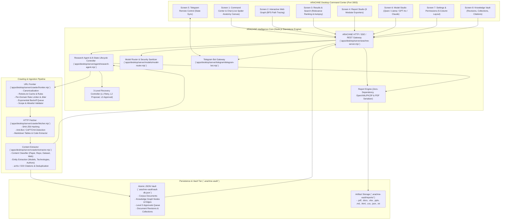

# ARACHNE System Architecture

## 1. System Vision & Architecture Overview

**ARACHNE** is an independent, permission-aware web intelligence and autonomous research platform. It unifies three core operational systems:

1. **Independent Search & Crawling Engine:** Discover, crawl, index, rank, and preserve permitted web content without sole dependence on any single proprietary search provider.
2. **Web Intelligence & Knowledge Graph Engine:** Interconnect domains, documents, entities, citations, and repositories into a queryable relational and topological graph with BFS path tracing.
3. **Autonomous Research Agent:** Translate natural-language directives into structured 5-phase investigation plans, dispatch permission-aware crawl/search actions, analyze evidence iteratively, recover from failures using a 3-level recovery controller, and compile multi-format research deliverables.

---

## 2. High-Level Architectural Diagram

---

## 3. Subsystem Breakdown

### 3.1 Desktop Command Center UI (8 Integrated Screens)

The UI adheres strictly to the cybernetic spider aesthetic blueprint:
- **Surfaces:** Void-black (`#06040a`) and deep-purple (`#0f091c`) frosted glass (`backdrop-filter: blur(16px)`).
- **Accents:** Neon violet (`#9d4edd`), neon magenta (`#f72585`), crimson (`#ff0054`), and restrained cyan (`#4cc9f0`).
- **Canvases:** Ambient animated cybernetic spiderweb canvas (`#ambient-spiderweb-bg`) and 60FPS pointer-reactive Living Mechanical Spider canvas (`#hero-spider-canvas`).

#### Screen 1: Command Center & Chat
- Natural language task intake supporting deep research directives.
- Level 3 Human Approval Alert Banner (`#approval-alert-banner`) with instant Approve/Reject actions.
- Autonomous pipeline controller with `Pause`, `Resume`, `Retry`, and `Stop` controls.
- Real-time execution logs and live overview telemetry cards.

#### Screen 2: Web Graph
- Interactive topology visualizer with glowing node clusters and particle-animated data edges.
- Color classification: Seed Source (Blue), Discovered Page (Purple), Relevant Source (Green), File/PDF (Orange), External Link (Pink), Error/Blocked (Red).
- Graph controls: Zoom In/Out, Fit to View, Expand Node, Clusters toggle, and Animation switch.
- BFS Shortest Path query: calculates and highlights shortest paths between nodes.

#### Screen 3: Results & Search
- Live full-text search with relevance threshold slider (0–100%).
- Multi-faceted filtering by content type (`Web Page`, `Research Paper`, `GitHub Repository`, `Documentation`, `Dataset`).
- Hunter's Vision Autopsy modal (`#modal-hunters-vision`): displays SHA-256 provenance, AI reasoning, discovered links, and raw extracted intelligence.

#### Screen 4: Report Studio
- Task-aware multi-format document generator.
- Generates and downloads **all 9 supported formats**:
  - `PDF`: Binary PDF-1.4 format with title headers, metadata table, and page streams.
  - `DOCX`: OpenXML Word Document with `word/document.xml`, styles, and relationships packaged as a valid PKZIP.
  - `XLSX`: OpenXML Spreadsheet Workbook with `xl/worksheets/sheet1.xml` and shared strings.
  - `PPTX`: OpenXML PowerPoint Presentation with slide decks and shapes.
  - `Markdown`: Full research dossier with headers, blockquotes, and tables.
  - `HTML`: Self-contained interactive report with void-black theme and print styles.
  - `CSV`: Tabular corpus export with relevance scores and domains.
  - `JSON`: Structured schema export with metadata, metrics, and entity lists.
  - `TXT`: Plain text research summary.

#### Screen 5: Telegram Remote Control
- Two-way interactive terminal mirroring backend state.
- Supports commands: `/status`, `/top5`, `/findings`, `/approvals`, `/approve <id>`, `/reject <id>`, `/report`, `/pause`, `/resume`, `/retry`, `/stop`.

#### Screen 6: Model Studio
- Top status banner showing active primary model, context length, and latency.
- Connected models fleet cards:
  - `Qwen 2.5 (Local)`: Primary reasoning & planning model (Ollama).
  - `Llama 3.1 (Local)`: Specialist extraction & classification model (LM Studio).
  - `GPT-4o (API)`: Fallback cloud verification model (OpenAI).
  - `Claude 3.5 Sonnet (API)`: Advanced deep analysis & code extraction model (Anthropic).
- Add Model panel: supports Ollama, LM Studio, vLLM, OpenAI Compatible, and Anthropic API.
- Model Configuration: temperature and max output token sliders, latency tester, and Make Primary switch.

#### Screen 7: Settings & Permissions (5-Column Layout)
- **🕷️ Crawling Settings:** Max concurrent requests (1–50), request delay (0–5s), max depth (1–10), robots.txt toggle, sitemaps toggle, subdomain crawl toggle, JS parsing toggle.
- **🛡️ Permissions & Scope:** Crawl scope selector (All public / Specific domains / Allowlist), allowlist chip manager, per-domain rate limit slider.
- **💾 Storage & Vault:** Storage location path, disk limit slider (50–1000 GB), compression & deduplication toggles, live vault meter.
- **📱 Telegram Bridge:** Enable toggle, bot token input, allowed user IDs list, approval alert toggles.
- **🎨 Theme & System:** Visual theme selector (Dark Void, Cyberpunk Neon, Obsidian Crimson), accent glow color swatches (`#9d4edd`, `#f72585`, `#ff0054`, `#4cc9f0`, `#10b981`), system telemetry toggle.

#### Screen 8: Knowledge Vault
- Real-time dynamic count indicators across content types.
- Time horizon dropdown filter (`All Time`, `Past 24 Hours`, `Past 7 Days`, `Past 30 Days`).
- Interactive Collections list.
- Preview Drawer with 4 inspector tabs: `Content`, `Metadata`, `Links`, `Entities`.

---

## 4. Crawling & Ingestion Pipeline

### URL Frontier (`apps/desktop/server/crawler/frontier.mjs`)
- **Canonicalization:** Strips URL tracking parameters (`utm_*`, `fbclid`, `ref`), lowercases hostnames, removes trailing slashes, drops hash fragments.
- **Robots.txt Parser & Cache:** Automatically fetches `/robots.txt`, parses `User-agent` directives, respects `Disallow` paths and `Crawl-delay` parameters, caching policies per origin.
- **Per-Domain Rate Limiting:** Enforces minimum intervals per domain with pseudo-random jitter (100–300ms) to avoid request bursts.
- **Exponential Backoff Queue:** Automatically retries failed URLs with exponential backoff (`delay = base * 2^retries + jitter`).
- **Scope Enforcement:** Validates target URLs against `all`, `domain`, or `allowlist` scope configurations.

### Fetcher (`apps/desktop/server/crawler/fetcher.mjs`)
- **SHA-256 Content Hashing:** Computes cryptographic hashes of all fetched content for tamper proofing and content deduplication.
- **Anti-Bot & CAPTCHA Detection:** Recognizes Cloudflare challenge pages, PerimeterX, and CAPTCHA walls; classifies errors as `BLOCKED_CHALLENGE`.
- **Markdown Conversion:** Cleans HTML, extracts readability bodies, and formats HTML tables and code fences into clean Markdown.

### Extractor (`apps/desktop/server/crawler/extractor.mjs`)
- **Automated Classification:** Identifies documents as `Research Paper`, `GitHub Repository`, `Documentation`, `Dataset`, or `Web Page`.
- **Entity Extraction:** Extracts AI Models, Repositories, Technologies, Authors, Datasets, and Organizations.
- **Citation Extraction:** Detects arXiv identifiers (`arXiv:\d{4}\.\d{4,5}`), DOIs (`10\.\d{4,9}/[-._;()/:A-Z0-9]+`), and citation headers.
- **Deduplication:** Discards duplicate pages by matching SHA-256 hashes against the existing Knowledge Vault corpus.

---

## 5. Knowledge Graph Engine (`apps/desktop/server/graph/knowledge-graph.mjs`)

- Directed multigraph tracking `Domain`, `Page`, `Document`, `Repository`, `Author`, and `Entity` nodes.
- Relations include: `LINKS_TO`, `CITES`, `AUTHORED_BY`, `MENTIONS`, `HOSTED_ON`, and `SIMILAR_TO`.
- **Graph Algorithms:**
  - `findPath(startId, endId)`: Breadth-First Search (BFS) finding the shortest relationship path between any two nodes.
  - `getDegree(nodeId)`: In-degree and out-degree centrality computation.
  - `filter(criteria)`: Faceted filtering by node type, domain, relevance score, and crawl status.

---

## 6. Research Agent & 3-Level Recovery Controller

### 8-State Persistent Lifecycle:
`QUEUED` → `PLANNING` → `DISCOVERING` → `CRAWLING` → `EXTRACTING` → `ANALYZING` → `VERIFYING` → `REPORTING` → `COMPLETED`
(with interrupt states: `PAUSED`, `WAITING_FOR_USER`, `FAILED`, `CANCELLED`).

### 3-Level Recovery Controller:
- **Level 1 (Autonomous Auto-Retry):** Transient network errors, socket timeouts, and 5xx status codes trigger exponential backoff retry up to 3 times without user interruption.
- **Level 2 (Model Alternative Proposal):** When a seed domain is blocked by anti-bot measures or 403 Forbidden, the model router queries Qwen to propose alternative research sources or search queries.
- **Level 3 (Human-in-the-Loop Approval Gate):** For external domains outside initial allowlists, high rate limits, or destructive operations:
  - Agent transitions to `WAITING_FOR_USER`.
  - Creates a pending approval in Vault Store.
  - Emits notification to Desktop UI `#approval-alert-banner` and Telegram bot `/approvals`.
  - Resumes execution upon receiving `approve` or `reject` decision.

---

## 7. Zero-Dependency OpenXML & PDF Exporters (`apps/desktop/server/reports/report-engine.mjs`)

ARACHNE generates native OpenXML and PDF binaries using standard Node.js libraries (`node:zlib`, `node:buffer`, `node:fs`):
- **PKZIP Builder:** Implements a pure-JavaScript ZIP archive builder using native `zlib.deflateRawSync` and `zlib.crc32`. Creates valid Local File Headers, Central Directory Records, and End of Central Directory (EOCD) records.
- **DOCX Exporter:** Packages `[Content_Types].xml`, `_rels/.rels`, `word/_rels/document.xml.rels`, `word/styles.xml`, and `word/document.xml`.
- **XLSX Exporter:** Packages `xl/workbook.xml`, `xl/styles.xml`, `xl/sharedStrings.xml`, and `xl/worksheets/sheet1.xml` containing research comparison matrices.
- **PPTX Exporter:** Packages `ppt/presentation.xml` and slide XML definitions with formatted text boxes and bullet lists.
- **PDF-1.4 Serializer:** Generates cross-reference tables (`xref`), trailer dictionaries, Font descriptors (`/Type /Font /Subtype /Type1 /BaseFont /Helvetica`), and content stream operators (`BT`, `Tf`, `ET`).

---

## 8. Multi-Agent Swarm Orchestrator (`apps/desktop/server/agent/swarm-orchestrator.mjs`)

ARACHNE employs a **Hierarchical Evaluator-Optimizer** multi-agent topology:
- **Lead Orchestrator:** Oversees the 8-stage investigation loop, resource budgeting, and human-in-the-loop gates.
- **Scout Specialist (`agent-scout`):** Executes search query expansion, traversal of sitemaps, RSS feeds, and scientific indexing engines.
- **Technical Analyst (`agent-analyst`):** Conducts in-depth AST parsing, entity classification, citation mapping, and source code inspection.
- **Fact Verifier & Gatekeeper (`agent-verifier`):** Computes source trustworthiness scores, identifies domain authority bonuses, and audits conflicting claims.
- **Dossier Synthesizer (`agent-synthesizer`):** Structures empirical findings, synthesizes comparison matrices, and packages final deliverables across all 9 formats.

---

## 9. Production RAG Pipeline & Hybrid Search (`apps/desktop/server/vault/rag-pipeline.mjs`)

- **Hybrid Lexical & Semantic Retrieval:** Combines BM25 Inverted Index keyword matching with character 3-gram TF-IDF vector cosine similarity.
- **Reciprocal Rank Fusion (RRF):** Merges disparate rank lists into a singular relevance distribution without requiring external vector database containers.
- **Semantic Overlapping Chunking:** Partitions long documents into 180-word windows with 40-word overlap to ensure cross-boundary semantic continuity.

---

## 10. Automated Contradiction & Claim Auditing

- Continuously analyzes corpus documents for conflicting performance benchmarks, opposing licensing claims, or mutually exclusive platform compatibility assertions.
- Categorizes conflicts by topic and severity, linking conflicting source URLs and verdicts directly to the UI Contradiction Matrix drawer.

---

## 11. Cinematic UI & Native Electron Desktop (`cinematic-ui` & `desktop-electron`)

- **Global Command Palette (`Ctrl+K` / `Cmd+K`):** Instant keyboard-navigable action modal for rapid screen switching, RAG retrieval, and hunt initiation.
- **Web Audio Soundscape Synthesizer:** Real-time procedural audio synthesis using HTML5 `AudioContext` for radar sweeps, discovery chimes, and warning sirens.
- **Native Electron Shell:** Includes native System Tray support, customized application menu accelerators, system notifications for Level 3 approvals, and native file save dialogs.

---

## 12. Dynamic Architecture Self-Introspection (`/api/system/architecture`)

Exposes a real-time introspection endpoint inspired by the `understand` skill. Client applications and external autonomous agents can query the exact running topology, component health, and control channels at runtime.

